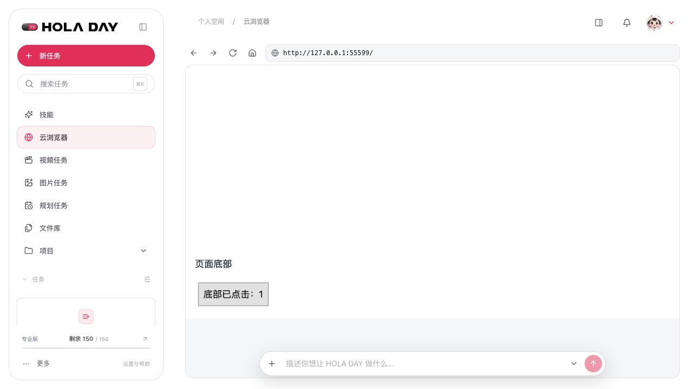

# 云浏览器入口与手动操作：本地验收

侧栏“云浏览器”进入 `/browser` 后，真实画面与手动操作已在本地完整 App 链路通过，并修复了滚动后点击被拒绝的问题。当前源码 `f2ccd2cb98aa606b754e1a1a07b626f258504f1d`，1833项运行输入；本轮没有模型或KMS调用、网站重导出、旧任务重放、合并和上线。[机器证据](evidence/browser-cloud-manual-local-20261120.json)

## 页面验证

使用真实HTTP/JWT、MySQL8.0.46隔离结构、原生BrowserPool、CDP画面流和生产人工输入守卫；前端使用逐文件匹配的332项冻结工作台文件。账号、目标网页和输入都是本地合成内容，生产数据库和真实账号未接入。验收为default模式，不注入维护排空控制器。

| 操作 | 实际结果 |
| --- | --- |
| 侧栏入口、地址打开 | 进入云浏览器，显示自有loopback网页 |
| 点击、文字、退格 | 计数1；“Hola 2026 中文输入”含退格修正，18次真实页面回执 |
| 滚动后点击 | 页面底部按钮由0变1 |
| 链接、后退、前进、刷新 | 第二页与首页地址逐步核对，刷新仍为第二页 |
| 主动断线、恢复 | 显示“正在连接画面…”，恢复后仍在第二页，原生PID97662不变 |
| 控制台及清理 | error/warn为0；HTTP/池/schema清理成功，外部核对进程组空、端口关闭，自有384MiB容器与临时密码删除 |

单次验收窗口345.52秒包含逐项人工工具操作，不是模型耗时或首帧延迟测量；不以此宣称任务速度改善。没有向任务发送框提交任务，独立SQL任务数为0。模型账本仍64/65且SHA不变；当前指令不允许使用剩余1次。

## 修复与检查

实际点击包和画面尺寸证明输入坐标正确；独立Chromium探针显示，滚动后`DOM.getNodeForLocation`需要文档坐标，而CDP输入使用视口坐标。现在仅在目标命中查询加上`cssVisualViewport.pageX/Y`，原始输入保持不变；坐标缺失或不可信仍拒绝。所有权、观察版本、敏感输入保护及原有受控退出守卫均保留。

新增两项真实Chromium回归先复现准确的命中失败，再通过修复；覆盖横向和纵向滚动、1×与2×显示比例，并独立查询目标节点核对授权指纹。最终78/78相关回归、3文件Biome、保留严格选项的定向类型检查及后端生产构建通过；测试heap1024MB、类型/构建2048MB，串行执行。作者串行审阅，没有冒称独立审查或全平台通过。

候选后端ZIP为4213759B/1616文件，SHA`7cad081f929995ae1b8ac961c82b8923977d27604011234b8fe1e5f1fcd52a24`；工作台`5e931b07…`与正式插件`c8bfb324…`按未变输入复用。三ZIP的CRC、文件集合和全部成员哈希通过；仅1项运行输入相对a5ed894a变化。新候选没有重验Linux/实际生产启动或真实模型；此前绑定/文件历史测试继续属于a5ed894a，4639的真实GitHub任务仍failed。

## 未完成范围

首轮显式注入ExecutionDrain的controlled模式在关闭时返回`POOL_PROCESS_GROUP_EXIT_UNPROVEN`。守卫按当前设计不能从leader/stdio回执证明整个进程组退出；未放宽该守卫。首轮资源已独立清理并验证，但该受控路径仍未通过；本轮default模式通过不能抵销这个缺口。测试入口现独立清理各资源并分别保留主错误与清理错误，避免错误遮盖或漏清理。

AWS工单179518008100001及既定每两小时只读跟进继续沿用；CloudShell账户核验阻塞真实KMS验收，不阻塞本次基础操作。真实KMS、Google稳定主体、账号保存/重建/失效/撤销/切换、物理输入、生产有效身份及受保护发布绑定仍未齐。整体Goal保持未完成，PR361保持草稿，不合并、不上线。
